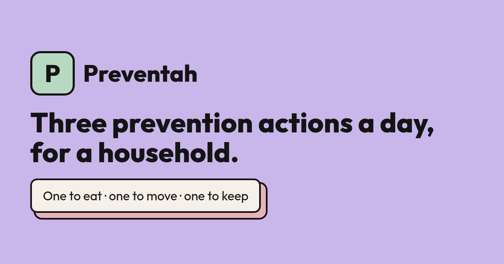

<div align="center">


# Preventah All Gas

### Prevent the diseases that run in your family, together.

Pick the conditions that run in your family, get one thing to eat, one way to move and one habit to keep each day, and see your household check theirs off in real time.

[**Open the live app**](https://qualified-hummingbird-614.convex.site) · [About](https://qualified-hummingbird-614.convex.site/about) · [FAQ](https://qualified-hummingbird-614.convex.site/faq) · [Privacy](https://qualified-hummingbird-614.convex.site/privacy) · [Hackathon log](./hackathon.md)

[](./LICENSE)




</div>

> [!NOTE]
> Built for the **Convex All Gas Hackathon**. General lifestyle guidance from public-health sources: not medical advice, not a diagnosis, not a prediction.

---

## Contents

- [Why a household](#why-a-household)
- [Features](#features)
- [How it works](#how-it-works)
- [Architecture](#architecture)
- [Getting started](#getting-started)
- [Configuration](#configuration)
- [Commands](#commands)
- [Deployment](#deployment)
- [Testing](#testing)
- [Project structure](#project-structure)
- [Safety and privacy](#safety-and-privacy)
- [License](#license)

---

## Why a household

Family history is a household fact, so prevention should be a household activity. People who share a kitchen share most of their diet, and a walk is easier when someone else is doing it too.

Preventah All Gas turns "heart disease runs in our family" into something concrete to do **today**, and makes it visible to the people you live with, without turning it into a scoreboard that shames anyone.

---

## Features

| | |
| --- | --- |
| **Three actions a day** | Eat, move, keep: drawn from curated public-health guidance and tagged to the conditions you picked. |
| **Live household board** | One subscribed Convex query, so a check-in on one phone appears on everyone else's immediately. No polling. |
| **Curated catalog** | 117 conditions, searchable by name and alias. No free text about anyone's health ever reaches the database. |
| **Consent first** | Nothing about family health is stored until consent is given; until then the server reports `needsConsent`. |
| **Accounts** | Convex Auth with email and password, plus Google when it is configured. A "Continue without an account" path keeps working. |
| **Invite links** | Share a `/start?invite=…` link to add someone to your household. Solo use is a household of one. |
| **Source cards** | Firecrawl looks up current pages for a selected condition, filtered to an allow-list of public-health domains (WHO, NHS, CDC, NIH and others). |
| **Morning plan and nudge** | AgentMail sends the day's actions at 07:00 local time, and a gentle nudge at 19:00 after a day with no check-in. |
| **Optional wording pass** | One OpenAI call per member per day can rephrase titles and one-liners. A strict validator rejects anything that adds a drug, dose, diagnosis, prediction or unsourced URL, and falls back to the catalog wording. |

Every integration degrades gracefully: with no Firecrawl, AgentMail or OpenAI key, the daily loop still works and the UI says what is missing.

---

## How it works

1. **Create an account** (or continue without one).
2. **Go solo or start a household**, or open an invite link.
3. **Consent** to what is stored.
4. **Choose a display name** for the board.
5. **Pick conditions** from the catalog.
6. **Do one of today's three and check it off.** The household board updates live.

The day's plan comes from a **pure, synchronous resolver** in `convex/lib/plans.ts`: the same selections and day always produce the same three actions, and opening the app never waits on a model or a network call. Check-ins are recomputed server-side against today's plan rather than trusting an action id from the client.

---

## Architecture

```text
Browser (Vite + React SPA)
  ↓  Convex client: realtime queries, mutations, actions
Convex deployment
  ├─ convex/http.ts         serves the embedded SPA + auth routes on *.convex.site
  ├─ queries / mutations    households, members, check-ins, catalog
  ├─ actions                Firecrawl source cards, OpenAI wording, AgentMail sends
  ├─ crons (hourly)         morning plan sweep (:00 UTC), nudge sweep (:30 UTC)
  └─ tables                 households, members, checkins, sourceCards,
                            dailyPlans, mailLog (+ Convex Auth tables)
  ↓
External: Firecrawl · AgentMail · OpenAI (gpt-5-nano → gpt-4.1-nano → gpt-4o-mini)
```

The app and its API share one origin. `scripts/embed-site.mjs` embeds the Vite build into `convex/siteAssets.ts`, and `convex/http.ts` registers an exact `GET` route for every page and asset. There is deliberately no `pathPrefix: "/"` catch-all.

Both cron sweeps run hourly and filter on each member's local clock, so one cron serves every timezone.

---

## Getting started

**Requirements:** Node.js (22 or newer to run the tests, which use `--experimental-strip-types`) and a [Convex](https://convex.dev) account.

```bash
git clone https://github.com/levithefirst/preventah-convex.git
cd preventah-convex
npm install
npm run dev              # = convex dev: creates/links a deployment, writes .env.local, regenerates convex/_generated
npm run dev:frontend     # in a second terminal: Vite dev server
```

Then, for accounts to work, the deployment needs Convex Auth keys. The repo generates them with [`scripts/initAuthKeys.mjs`](./scripts/initAuthKeys.mjs), which is what the manual `init-auth` GitHub workflow runs. It sets `JWT_PRIVATE_KEY`, `JWKS` and `SITE_URL` and will not overwrite existing keys without `--force` (rotating them signs every session out).

---

## Configuration

### Frontend (`.env.local`, written by `convex dev`)

| Name | Purpose |
| --- | --- |
| `CONVEX_DEPLOYMENT` | Which Convex deployment the CLI targets |
| `VITE_CONVEX_URL` | The deployment URL the SPA connects to |

The tracked `.env` holds only the public production `VITE_CONVEX_URL`. Without it, `vite build` folds the URL to `undefined` and ships a bundle containing only a "not configured" message.

### Deployment environment (set with `npx convex env set`, never in a file)

| Name | Required | Purpose |
| --- | --- | --- |
| `JWT_PRIVATE_KEY`, `JWKS` | for accounts | Convex Auth signing keypair |
| `SITE_URL` | for accounts | The site origin Convex Auth checks against |
| `AUTH_GOOGLE_ID`, `AUTH_GOOGLE_SECRET` | optional | Enables Google sign-in when both are set |
| `FIRECRAWL_API_KEY` | optional | Source cards; without it they stay empty and say why |
| `AGENTMAIL_API_KEY` | optional | Morning plan and nudge emails |
| `AGENTMAIL_INBOX_ID` | optional | Inbox to send from; otherwise the first inbox is used |
| `OPENAI_API_KEY` | optional | Daily wording pass; without it the catalog wording is shown |

### GitHub Actions secret

| Name | Used by |
| --- | --- |
| `CONVEX_DEPLOY_KEY` | `allgas-deploy.yml` and `init-auth.yml` |

---

## Commands

| Command | What it does |
| --- | --- |
| `npm run dev` | `convex dev`: push functions on change and regenerate types |
| `npm run dev:frontend` | Vite dev server for the SPA |
| `npm run build:app` | `vite build` only |
| `npm run build:site` | Embed `dist/` into `convex/siteAssets.ts` |
| `npm run build` | Both of the above |
| `npm run typecheck` | `tsc -p tsconfig.app.json --noEmit` |
| `npm test` | Node test runner over `tests/*.test.ts` |
| `npm run deploy` | `convex deploy`, building and embedding the site first |

---

## Deployment

```bash
npm run deploy
```

This builds the SPA, embeds it into `convex/siteAssets.ts`, and pushes functions and site together. The app is then live on the deployment's `.convex.site` origin.

CI does the same: [`.github/workflows/allgas-deploy.yml`](./.github/workflows/allgas-deploy.yml) deploys on every push to `main` (and on manual dispatch) using `CONVEX_DEPLOY_KEY`.

| Workflow | Trigger | What it does |
| --- | --- | --- |
| `allgas-deploy.yml` | push to `main`, manual | Deploy backend and embedded site |
| `init-auth.yml` | manual | Generate and set Convex Auth keys over stdin, never in logs |
| `auth-doctor.yml` | manual | Read-only diagnostics of the deployment's auth setup |

`convex/siteAssets.ts` is generated and committed so a fresh clone can deploy in one command. Do not edit it by hand.

---

## Testing

```bash
npm test
```

48 tests across three suites, no deployment needed:

- **`loop.test.ts`**: a plan resolves for any input including nonsense, the same selections and day give the same plan, and the condition sanitizer drops anything that is not a catalog id.
- **`rewrite.test.ts`**: the OpenAI wording guard, against a stubbed `fetch`. Invented drugs and diagnosis wording are rejected end to end, the model chain advances exactly once on a 404, and the catalog's own wording always validates so the guard can never silently disable the layer.
- **`routes.test.ts`**: every client route and embedded asset is served by `convex/http.ts`, and the server and client agree on the route list.

---

## Project structure

```text
convex/
  schema.ts            tables and indexes
  households.ts        create/join households, the live board
  members.ts           consent, conditions, today's actions
  checkins.ts          check-in mutation
  catalog.ts           condition search
  sources.ts           Firecrawl source cards
  plansGenerate.ts     daily OpenAI wording pass
  mail.ts, crons.ts    AgentMail morning plan + nudge
  auth.ts, account.ts  Convex Auth providers, claiming a pre-account member
  http.ts              static site router + auth routes
  siteAssets.ts        generated: the embedded SPA
  lib/                 condition catalog, plan content, resolver, rewrite guard
src/                   React SPA: landing, onboarding, Today, Board, Profile, public pages
public/                icons, fonts, OG card, robots/sitemap/llms.txt, security.txt
scripts/               site embedder, auth key init, auth/browser probes
tests/                 Node test runner suites
hackathon.md           dated build log
```

---

## Safety and privacy

- **Not medical advice.** A family history raises the value of prevention and of a conversation with a clinician; it does not mean anyone will develop a condition. The app never scores or predicts risk.
- **No free text.** Conditions are catalog ids; anything else is dropped by the sanitizer.
- **The model cannot add clinical content.** The wording pass may only rephrase, and anything it introduces that the catalog did not say is rejected whole.
- **Nothing is traffic-lit.** Done is mint, not done is cream. A quiet day reads as quiet, not as failure.
- **Secrets live on the deployment.** API keys are read from the Convex environment at run time; auth keys are set over stdin in CI.
- **No analytics, pixels or cookie banner.** The `/privacy` page lists every stored field and each processor.

The [hackathon log](./hackathon.md) records every design decision, bug and verification step in detail.

---

## License

MIT. See [LICENSE](./LICENSE).
